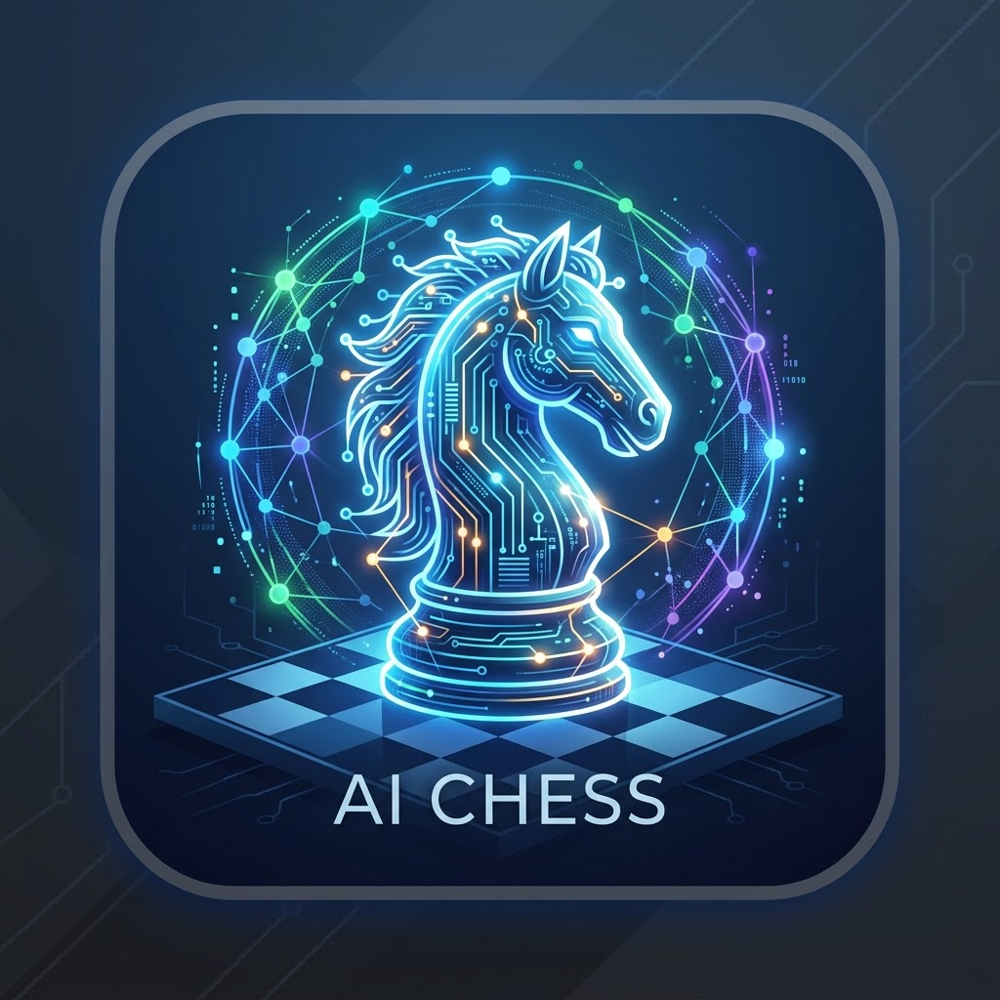

# ♟️ AI Chess — MCP Ready


Juega al ajedrez contra Stockfish 16 desde terminal o desde cualquier agente compatible con MCP.

> **¿Eres un agente?** Lee [`docs/AGENTS.md`](docs/AGENTS.md): conexión en
> Claude Desktop, receta de entrenamiento y catálogo esencial para
> modelos pequeños.



> Splash de carga: `assets/splash.png` (originales en raíz: `aichess.png`, `aichesssplashscreen.png`).
> Nota: los PNG son JPEG renombrados (1024x1024 icono, 1024x572 splash). Para GUI futura renombrar a `.jpg` o reconvertir.

## Requisitos

- Python 3.10+ (probado en 3.13.3)
- Stockfish 12+ (`sudo apt install stockfish`; `UCI_Elo` requiere 12+. Si está en
  otra ruta o con otro gestor, define `STOCKFISH_PATH=/ruta/a/stockfish` —
  imprescindible con clientes MCP de PATH reducido como Claude Desktop)
- Para PNG: `libcairo2` a nivel de sistema (`sudo apt install libcairo2`)
- venv + pip

## Instalación

```bash
git clone https://github.com/kayab999/AIChess && cd AIChess
python3 -m venv .venv
.venv/bin/pip install -r requirements.txt
# suite de regresión (37+ tests):
.venv/bin/pip install -r requirements-dev.txt && .venv/bin/python -m pytest tests/ -q
```

## Test rápido (sin MCP)

```bash
.venv/bin/python cli_test.py
```

Comandos: `e4`, `Nf3`, `e2e4`, `O-O` | `hint [1|2|3]` | `explain` | `coach on/off` | `pgn` | `save [ruta]` | `load <ruta>` | `games` | `status` | `moves` | `analyze` | `undo` | `resign` | `quit`

## Uso como servidor MCP (stdio, SDK 2.x)

```bash
.venv/bin/python chess_mcp_server.py
```

Registro en cliente MCP (Claude Desktop / genérico):

```json
{
  "mcpServers": {
    "ai-chess": {
      "command": "/ruta/a/AIChess/.venv/bin/python",
      "args": ["/ruta/a/AIChess/chess_mcp_server.py"],
      "env": { "STOCKFISH_PATH": "/usr/games/stockfish" }
    }
  }
}
```

## Herramientas

| Herramienta | Descripción |
|---|---|
| `new_game(elo=1600)` | Nueva partida (1320-3190) |
| `new_game(personality="tal")` | Nueva partida contra una personalidad (fija su ELO) |
| `make_move(move)` | Juega en SAN o UCI, el bot responde |
| `get_board(color=false)` | Tablero Unicode; `color=true` da ANSI (casillas, última jugada, jaque) |
| `get_status` | Turno, jaque, resultado, historial |
| `get_legal_moves` | Legales en SAN |
| `undo` | Deshace la última ronda (reabre tras mate/abandono) |
| `resign` | Abandona (0-1) |
| `claim_draw` | Reclama tablas (triple repetición / 50 jugadas) |
| `analyze(depth=15)` | Evaluación + mejor jugada |
| `hint(level=1)` | Pista 1=idea, 2=zona, 3=exacta (auto-escala) |
| `explain_move` | Veredicto + pérdida + consejo última jugada |
| `build_coach_context` | Contexto + prompt para que tu LLM redacte el consejo (no llama a ningún LLM) |
| `coach_status` | Colgadas, desarrollo, seguridad rey |
| `toggle_coach(enabled)` | Activa/desactiva feedback automático |
| `export_pgn` | Partida actual en PGN estándar |
| `save_game(path="")` | Guarda en `games/` (sandbox: solo nombres, auto-nombre con fecha) |
| `load_game(path)` | Carga PGN de `games/` y restaura tablero |
| `list_games` | Lista partidas en `games/` |
| `get_board_svg(orientation="blancas")` | Tablero 2D SVG en `boards/`, devuelve ruta |
| `save_board_image(path="", orientation="blancas")` | Guarda SVG en ruta dada o auto-nombre |
| `get_board_png(orientation="blancas", size=960)` | Tablero PNG en `boards/` (256-2048), devuelve ruta |
| `save_board_png(path="", orientation="blancas", size=960)` | Guarda PNG en ruta dada o auto-nombre |
| `get_board_viewer(refresh=5)` | Visor HTML (splash + tablero + coach) en `boards/viewer.html` |
| `list_personalities` | 15 personalidades: arquetipos + leyendas |
| `set_personality(key)` | Cambia de rival e inicia partida |
| `lookup_history` | Qué jugaron Fischer/Tal en la posición actual |
| `opening_info` | Nombre ECO + líneas de las leyendas |
| `search_classics(player)` | Busca clásicas por jugador |
| `list_3d_styles` | 4 estilos 3D disponibles |
| `get_board_3d(style="clasico")` | Visor 3D animado en `boards/viewer3d-<estilo>.html` |

El usuario juega blancas, el bot negras. ELO default 1600. Coach activo por defecto.
El ELO es real: escala el muestreo con estilo (temperature/blunder), porque
Stockfish ignora `UCI_Elo` en análisis MultiPV. Invariante de estado: `result`
solo existe en partida terminada; `undo`/`load`/`claim` la reconcilian siempre.

## Modo entrenador 🎓

Tras cada `make_move`: `✅ bien / ⚠️ imprecisión (<70cp) / ❌ error (<180cp) / 💥 blunder / 💀 grave` + motivo (colgada, sin desarrollar, rey expuesto). Latencia extra ~0.6s (2x análisis acotado `time=0.3 depth=10`).

## Estructura

```
coach.py             # Detección + clasificación + hints (sin motor)
personalities.py     # 15 perfiles estilo The King + muestreo con estilo
eco.py               # Tabla ECO manual (~30 aperturas)
history.py           # Índice de 162 clásicas CC0 (Fischer 60 + Tal 102)
fetch_classics.py    # Descarga data/classics/ (reproducible)
viewer3d.py          # Genera el visor 3D con la partida embebida
assets3d/            # three.js vendorizado + pieces.js + board3d.js + plantilla
chess_engine.py      # Núcleo python-chess + Stockfish (sin MCP)
chess_mcp_server.py  # MCPServer 2.x, 29 tools, stdio (claim_draw incluido)
tournament.py        # Round-robin entre personalidades
cli_test.py          # CLI con banner + referencia a splash/icono
games/               # Partidas PGN guardadas
boards/              # Tableros SVG generados
```

## Tablero ANSI 🎨

CLI a color por defecto (solo si la terminal lo soporta). Última jugada en amarillo, rey en jaque en rojo. Comandos `color on/off`. MCP devuelve plano por defecto para no romper agentes; pide `get_board(color=true)` para ANSI. Respeta `NO_COLOR=1`.

## Tablero 2D 🖼️

SVG vectorial sin dependencias nuevas (`chess.svg`). Última jugada en amarillo, jaque resaltado, orientación `blancas/negras`. CLI: `svg [blancas|negras]`. MCP devuelve la ruta en `boards/`. Nombres con microsegundos (sin colisiones).

## Tablero PNG 🖼️

Raster vía `cairosvg` (requiere `pip install -r requirements.txt`) desde el mismo SVG: cero divergencia visual. 960px por defecto (256-2048). CLI: `png [blancas|negras] [tamaño]`. MCP devuelve la ruta en `boards/`.

## Visor HTML 🌐

Monofichero `boards/viewer.html` (~500 KB, autocontenido: splash + icono en base64, SVG inline). Splash a pantalla completa 1.5s, favicon del proyecto, panel con turno/estado/ELO/jugadas/coach. Auto-refresh 5s (configurable, 0 = off). CLI: `viewer [refresh]`. Flujo en vivo: abre el HTML y regenera tras cada jugada.

## Personalidades 🎭

Fiel a The King (Chessmaster): King Safety, Mobility, Randomness y valores de piezas, más repertorios de apertura. 7 arquetipos (`club` default ELO 1600, `novato`, `stanley` homenaje al chimpancé aleatorio de CM9000, `vikingo`, `muro`, `profesor`, `maestro`) + 8 leyendas (`alekhine`, `fischer`, `botvinnik` — el trío canónico del match CM9000 vs Christiansen 2002 — más `karpov`, `kasparov`, `capablanca`, `tal`, `carlsen`).

CLI: `personalities` (lista) · `personality <key>` (cambia de rival). Torneo:

```bash
.venv/bin/python tournament.py --players vikingo,muro,profesor --games 2 --time 0.2
```

## Visor 3D 🧊

Three.js r128 vendorizado en `assets3d/` (offline, `file://`). Piezas paramétricas FIDE (torno `LatheGeometry` + remates) en 4 estilos: `clasico` (Staunton madera), `antiguo` (Lewis marfil/rojo, peones losa), `cyberpunk` (neón translúcido + grid), `wizard` (piedra rúnica, chispas, balanceo). Replay animado de la partida al cargar (arco, capturas, coronación), jaque pulsante, órbita con zoom. CLI: `3d [clasico|antiguo|cyberpunk|wizard]`.

## Base histórica 📜

162 clásicas CC0 commiteadas en `data/` (Fischer 60 + Tal 102; `.venv/bin/python fetch_classics.py` para re-descargar). `history.py` indexa todas las posiciones; el coach cita automáticamente ("Fischer jugó e4 aquí, Mar del Plata 1959"). CLI: `history` (citas) · `opening` (ECO + líneas legendarias).

## Roadmap

- [x] MVP jugable + MCP stdio
- [x] Modo entrenador (feedback + hints 3 niveles)
- [x] Colores ANSI
- [x] PGN (exportar/guardar/cargar/listar)
- [x] Tablero gráfico 2D (SVG)
- [x] PNG raster (cairosvg, 960px default)
- [x] Visor HTML con splash (auto-refresh)
- [x] Personalidades Chessmaster + torneo
- [x] Base PGN histórica (Fischer + Tal, citas + ECO)
- [x] Piezas 3D (4 estilos, Three.js animado)
