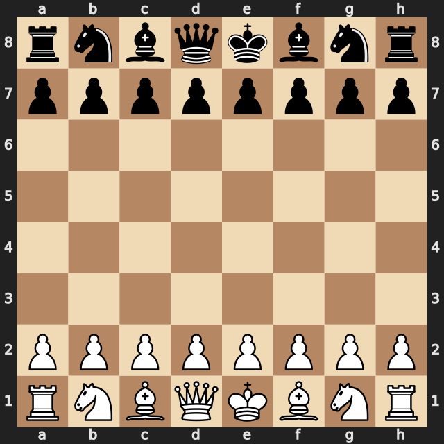
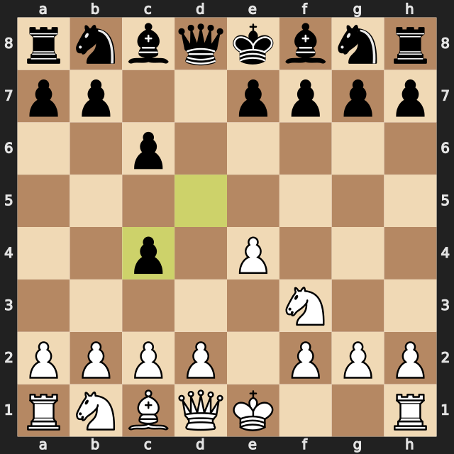

# Demo en 30 segundos (salida real del proyecto)

Sesión auténtica de `cli_test.py` (copia y pega estos comandos):

```
> e4
🎓 ✅ bien (12cp): Buena jugada e4.

> hint
💡 Nivel 1: Controla el centro y coordina tus piezas antes de atacar.
```

Tablero inicial:



Tras `1.e4 c6 2.Nf3 d5 3.Bc4 dxc4` (Caro-Kann, el bot ya captura):



Con un agente MCP, la misma partida añade el modo híbrido:

```
> make_move e4
🎓 Entrenador: ✅ bien — Bien jugado e4. (...)
📜 Historia: Robert James Fischer jugó e4 aquí (Mar del Plata, 1959, 1-0)

> build_coach_context
Eres un entrenador de ajedrez... [el agente redacta el consejo final]
```

Ver `docs/AGENTS.md` para el flujo completo agente + LLM.
